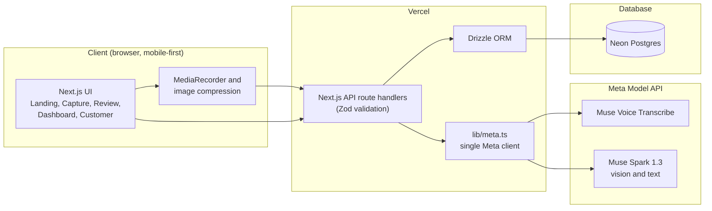
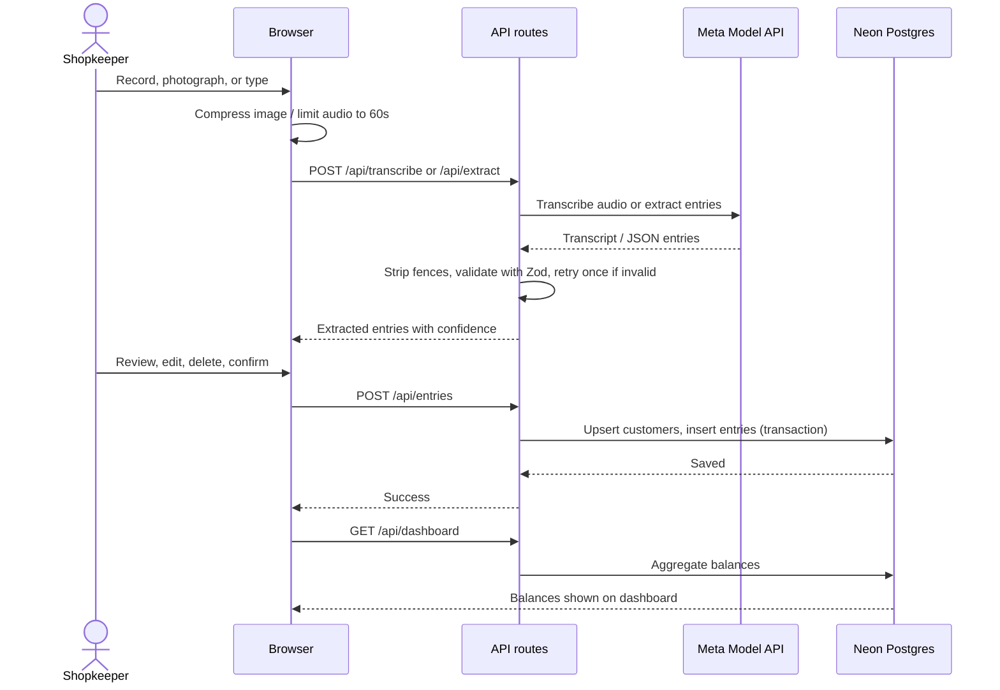
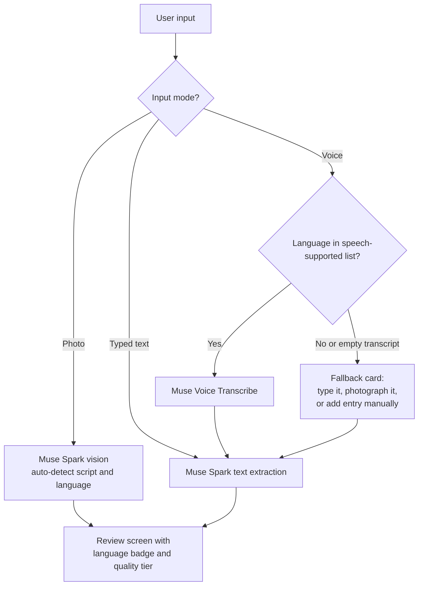
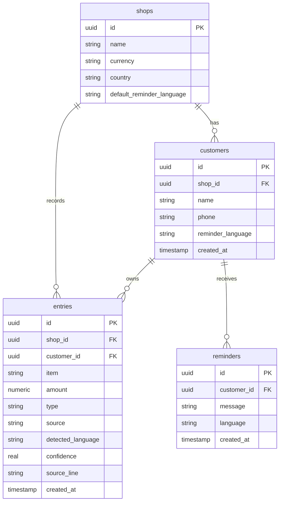
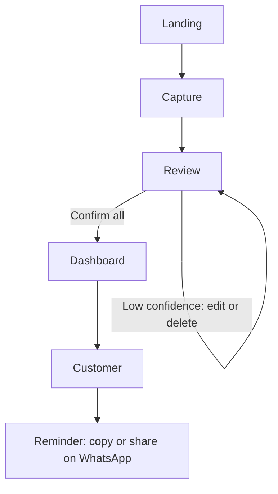
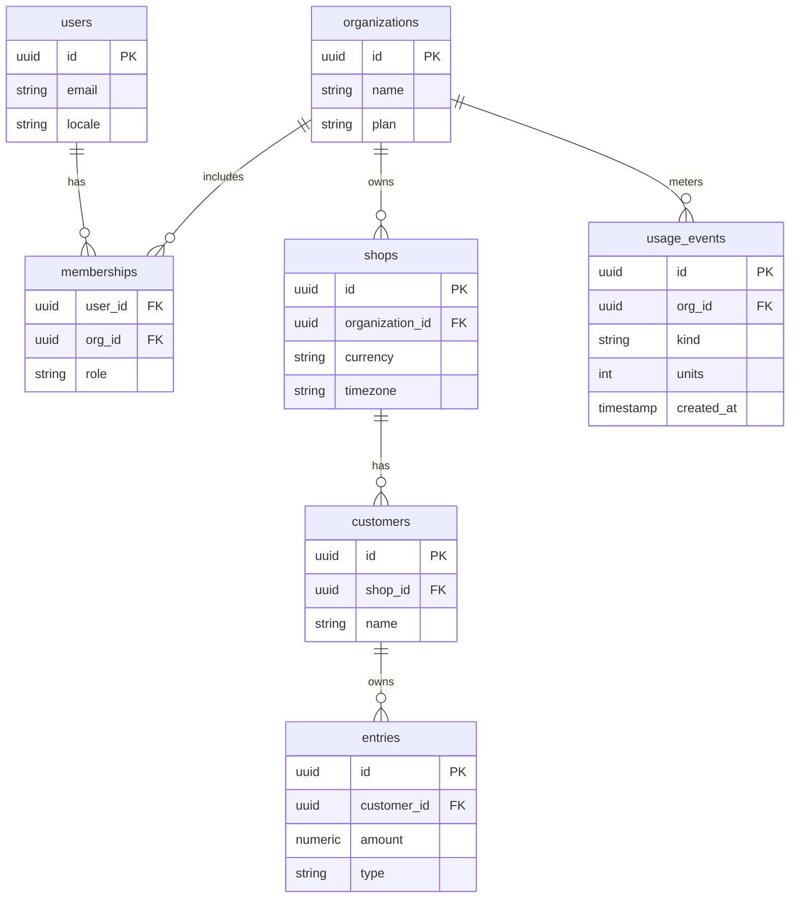
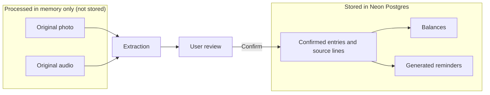

# TabTalk

**Your shop's notebook, in any language.**

TabTalk turns spoken or handwritten credit notes into a reviewable ledger and respectful payment reminders, for small shopkeepers anywhere in the world.

[](https://tabtalk-development-alpha.vercel.app/)


**Live demo:** https://tabtalk-development-alpha.vercel.app/

Built for the **Meta Global AI Developer Hackathon**, Track: **Build for Your World**.

---

## Table of contents

1. [Try it in 60 seconds](#try-it-in-60-seconds)
2. [The problem](#the-problem)
3. [The solution](#the-solution)
4. [Features](#features)
5. [How we use Meta's models](#how-we-use-metas-models)
6. [Architecture](#architecture)
7. [Language support](#language-support)
8. [Privacy and security](#privacy-and-security)
9. [API reference](#api-reference)
10. [Tech stack](#tech-stack)
11. [Project structure](#project-structure)
12. [Getting started](#getting-started)
13. [Deploying to Vercel](#deploying-to-vercel)
14. [Environment variables](#environment-variables)
15. [Testing](#testing)
16. [Limitations](#limitations)
17. [Future scope](#future-scope)
18. [What was built during the hackathon](#what-was-built-during-the-hackathon)
19. [Team, license, acknowledgements](#team-license-acknowledgements)

---

## Try it in 60 seconds

1. Open the live demo: https://tabtalk-development-alpha.vercel.app/
2. Choose **Try the demo**. No sign-up is needed.
3. Pick one input mode on the capture screen:
   - **Speak**: record a short note, for example "Ravi took rice and oil, 450 on credit".
   - **Photograph page**: upload a photo of a handwritten ledger page.
4. On the **Review** screen, check each extracted entry next to its original line. Anything with low confidence is flagged in amber.
5. Choose **Confirm all**. The **Dashboard** now shows who owes what.
6. Open a customer and choose **Draft reminder** to get a polite message in the customer's language.

The demo includes three seeded shops (Tamil-English in INR, Spanish in MXN, English/Swahili in KES) so you can see the dashboard and currency formatting straight away.

---

## The problem

Small shops all over the world sell on credit, and the record of who owes what usually lives in a paper notebook, in someone's memory, or on loose pages. The practice has many names: **khata**, **udhaar** (South Asia), **fiado** (Latin America), **utang** (Philippines), or simply "on credit".

This breaks down in predictable ways:

- Pages get lost or damaged, and balances go with them.
- Handwriting is hard to read, even for the person who wrote it.
- Entries are written and spoken in mixed languages and scripts, which most software handles badly.
- Chasing payment is awkward, takes time, and strains relationships with regular customers.

Most bookkeeping apps assume the shopkeeper will type structured data in one language. That is not how these shops work.

## The solution

TabTalk meets shopkeepers where they already are: they speak or write the way they always have, and the app does the structuring.

**Flow:** Landing → Capture → Review → Dashboard → Customer → Reminder

1. **Capture.** Speak a note or photograph a handwritten page (a typed fallback is available).
2. **Extract.** Meta's models turn the input into structured entries: customer, item, amount, credit or paid, confidence, and the original source line.
3. **Review.** The shopkeeper checks every entry next to its original line. Low-confidence entries are flagged and shown first. Nothing is saved until the shopkeeper confirms.
4. **Track.** The dashboard shows total outstanding and a per-customer balance in the shop's own currency.
5. **Remind.** TabTalk drafts a short, respectful reminder in the customer's language, ready to copy or share by WhatsApp.

Design principles:

- **Verify before save.** AI output is a draft, never a record.
- **Show the evidence.** The original line sits beside the extracted text.
- **Honest about quality.** Languages are labelled by how well they are supported.

---

## Features

- Voice capture through the browser MediaRecorder API, and handwritten-page upload.
- Server-side Meta model calls, with Zod validation of every model output.
- Review-before-save screen with confidence flags and original source text.
- Credit and paid entries, per-customer balances, and multi-currency formatting.
- Reminder drafting in the customer's language, with copy and WhatsApp share.
- Demo shops for INR, MXN, and KES.
- A language registry built from `Intl.DisplayNames`, with quality tiers and fallbacks (see [Language support](#language-support)).

---

## How we use Meta's models

All model calls are server-side and live in one module, `lib/meta.ts`, so the rest of the app never touches model details.

| Model | Code location | Purpose |
|---|---|---|
| Muse Voice Transcribe | `lib/meta.ts` → `transcribeAudio` | Converts a recorded voice note to text via the speech-to-text endpoint. |
| Muse Spark 1.3 (vision) | `lib/meta.ts` → `extractFromImage` | Reads handwritten ledger pages and returns structured entries. |
| Muse Spark 1.3 (text) | `lib/meta.ts` → `extractFromText`, `draftReminder` | Structures transcripts and typed text, and writes multilingual reminders. |

Standard models are used. The contributor variants are not used, so customer data is not used to train models.

---

## Architecture

### 1. System architecture



The browser only talks to our route handlers. Only server code holds the Meta API key and the database connection string, and all model access goes through `lib/meta.ts`.

### 2. Capture-to-ledger sequence



The review step is the correction loop: nothing reaches the database until the shopkeeper confirms it. Model output that fails validation is retried once with the validation error appended, then surfaces as a clear error.

### 3. Language routing



Every input path ends at the same review screen. Voice has a guaranteed fallback, so a language that speech recognition does not cover never blocks a shopkeeper.

### 4. Data model



A customer's balance is computed as the sum of `credit` entries minus the sum of `paid` entries.

### 5. User flow



Low-confidence entries stay visible and sorted first until they are corrected or removed.

### 6. Production upgrade: multi-tenant model

This is the design the `saas-upgrade` branch moves towards. Shops belong to organizations, and access always comes from the server session, never from a client-supplied shop ID.



### 7. Privacy boundary



Photos and audio are used to produce a draft and then discarded. Only what the shopkeeper confirms is saved.

---

## Language support

TabTalk accepts any language and script, and is honest about how well each one is supported. The language list is generated from `Intl.DisplayNames` rather than a short hard-coded picker, and every language falls into one of three tiers:

| Tier | Meaning | Where it comes from |
|---|---|---|
| **Verified** | We tested the full flow (extract, review, reminder) in this language. | `TESTED_LANGUAGES` in `lib/config.ts`. This build lists English, Tamil, and Spanish. |
| **Speech supported** | Muse Voice Transcribe lists the language, so voice capture should work. | `SPEECH_SUPPORTED` in `lib/config.ts`, taken from Meta's speech-to-text documentation. |
| **Best effort** | Handwriting, typed text, and reminders are attempted by Muse Spark, but quality varies. | Everything else. |

Fallbacks keep the app useful in any language:

- If voice recognition does not cover a language, or returns an empty or low-confidence transcript, the app suggests typing, photographing the page, or adding an entry manually.
- For best-effort languages, reminders are editable and carry a "read before sending" note.
- Amounts are normalised across digit systems and separators (for example `1,00,000`, `100.000`, `100 000`) and formatted with `Intl.NumberFormat` in the shop's currency.
- Text uses `dir="auto"` so right-to-left scripts display correctly.

We do not claim that every language works well. Outside the verified list, the review step is what protects the shopkeeper from mistakes.

---

## Privacy and security

**What is stored**

- Confirmed entries, their source lines, customer names, balances, and generated reminders, in Neon Postgres.

**What is not stored**

- Original photos and audio are processed in memory and are not persisted by default.

**How data is protected**

- The Meta API key and database URL stay server-side and never reach the browser.
- Meta Standard models are used, so content is not used for model training.
- Every request body and every model output is validated with Zod.
- Model output is treated as untrusted data and is rendered as plain text. The extraction prompt instructs the model to ignore any instructions found inside handwriting or speech.

**Production upgrade (`saas-upgrade` branch)**

The upgrade adds Auth.js, organization-aware access helpers (`requireShopAccess`), rate-limit and usage-plan primitives, a health check, security headers, and a no-signup sandbox for judges and first-time visitors. Client-supplied shop IDs must never be treated as authorization.

> The privacy and terms templates in this project are drafts and need legal review before any commercial launch.

---

## API reference

| Method and route | Purpose |
|---|---|
| `POST /api/transcribe` | Audio (60 seconds max) in, transcript out. |
| `POST /api/extract` | Transcript, typed text, or image in; validated entries out. |
| `POST /api/entries` | Save confirmed entries (upserts customers, one transaction). |
| `GET /api/dashboard` | Total outstanding, per-customer balances, recent entries. |
| `GET /api/customers/[id]` | One customer's ledger and balance. |
| `POST /api/reminder` | Draft and store a reminder in a chosen language. |
| `GET /api/shop`, `PUT /api/shop` | Read and update shop name, currency, and default reminder language. |
| `GET /api/health` | Health check (database ping, no secrets). |

Model-calling routes set `maxDuration = 60`. Vercel request bodies are limited to about 4.5 MB, so images are compressed in the browser (1600px longest side, JPEG quality 0.8) before upload.

---

## Tech stack

| Layer | Choice |
|---|---|
| Framework | Next.js (App Router), TypeScript strict |
| Styling | Tailwind CSS, Noto Sans font families for multi-script text |
| API | Next.js route handlers |
| Database | Neon Postgres with Drizzle ORM |
| Validation | Zod |
| AI | Meta Model API: Muse Voice Transcribe, Muse Spark 1.3 |
| Hosting | Vercel |

---

## Project structure

```text
app/              pages and API route handlers
  api/            transcribe, extract, entries, dashboard, customers, reminder, shop, health
components/       reusable UI (EntryCard, CropPreview, ReminderPanel, ...)
  landing/        landing page sections
lib/              Meta client, schemas, prompts, money, languages, database
db/               Drizzle schema and seed
scripts/          smoke checks against the real Meta API
```

---

## Getting started

**Prerequisites**

- Node.js 20 or newer
- A Neon account (free tier is enough)
- A Meta Model API key with credits (a payment card must be on file to make calls)

**Run locally**

```bash
git clone <your-repo-url>
cd <your-repo-folder>
npm install
cp .env.example .env.local     # then fill in the values (see below)
npx drizzle-kit migrate
npm run seed
npm run dev
```

Open http://localhost:3000.

**Verify the Meta connection**

```bash
npm run smoke
```

This makes one real call each for voice, image, text, and reminders. Run it before debugging anything else.

**Troubleshooting**

| Symptom | Likely cause and fix |
|---|---|
| 401 or "invalid API key" | Check `META_API_KEY` in `.env.local`, then restart the dev server. |
| Model calls fail with a billing or credit error | Claim your credits and make sure a payment method is on the Meta account. |
| Transcription fails or times out | Keep recordings under 60 seconds; check the transcribe endpoint in the Meta docs. |
| Upload fails on a large photo | Images should be compressed to about 1600px; the body limit is about 4.5 MB on Vercel. |
| Database errors | Check `DATABASE_URL` and run `npx drizzle-kit migrate` again. |
| Empty dashboard | Run `npm run seed`. |

---

## Deploying to Vercel

1. Push the project to a **public** GitHub repository.
2. Import the repository in Vercel.
3. Add the **Neon** integration (this sets `DATABASE_URL`).
4. Set the environment variables listed below.
5. Run the migration and seed against the production database.
6. Verify with `npm run smoke` (pointing at production variables) and by trying the live demo.

Keep two platform limits in mind: request bodies up to about 4.5 MB, and a 60-second duration on the model-calling routes.

Current deployment: https://tabtalk-development-alpha.vercel.app/

---

## Environment variables

| Variable | Required | Purpose |
|---|---|---|
| `META_API_KEY` | Yes | Server-only Meta Model API credential. |
| `META_BASE_URL` | Yes | Meta API base URL (default `https://api.meta.ai/v1`). |
| `META_MODEL_VISION` | Yes | Vision model ID (default `muse-spark-1.3`). |
| `META_MODEL_TEXT` | Yes | Text model ID (default `muse-spark-1.3`). |
| `META_MODEL_TRANSCRIBE` | Yes | Speech model ID (default `muse-voice-transcribe-1.0`). |
| `DATABASE_URL` | Yes | Neon Postgres connection string. |
| `NEXT_PUBLIC_DEMO_VIDEO_URL` | Optional | Demo video link shown on the landing page. |
| `NEXT_PUBLIC_REPO_URL` | Optional | Repository link shown on the landing page. |
| `AUTH_SECRET`, `AUTH_URL`, `AUTH_GOOGLE_ID`, `AUTH_GOOGLE_SECRET` | Upgrade branch | Auth.js configuration. |
| `RESEND_API_KEY`, `EMAIL_FROM` | Upgrade branch | Magic-link email sign-in. |
| `UPSTASH_REDIS_REST_URL`, `UPSTASH_REDIS_REST_TOKEN` | Upgrade branch | Rate limiting. |
| `AI_DAILY_CAP`, `CRON_SECRET` | Upgrade branch | Daily AI spend guard and cron protection. |
| `BILLING_ENABLED`, `STRIPE_*` | Upgrade branch (optional) | Billing, off by default. |

Never commit `.env*` files. Only the two `NEXT_PUBLIC_` variables may be exposed to the browser.

---

## Testing

- **Smoke test:** `npm run smoke` calls the real Meta API for voice, image, text, and reminders.
- **Manual checklist:**
  - A Tamil, a Spanish, and an English entry each extract correctly.
  - Low-confidence entries are flagged and shown first.
  - Confirming entries updates the dashboard balances.
  - A reminder is generated in a language different from the entry's language.
  - Switching shop changes the currency formatting (INR, MXN, KES).
  - All landing page buttons work.
  - No API key is visible in the browser's network tab.

### Tested languages

Only languages that were actually verified are listed in `TESTED_LANGUAGES`. This build lists **English, Tamil, and Spanish**.

---

## Limitations

- Handwriting accuracy varies with legibility, script, and photo quality.
- Model output can be wrong, which is why review-before-save is required.
- The demo uses seeded demo shops and does not require authentication.
- There is no offline mode yet.
- Languages outside the verified list are best effort.
- Reminders are drafted but not sent automatically; the shopkeeper copies or shares them.

---

## Future scope

- Multi-shop accounts with roles for family-run shops.
- Offline-first PWA with a sync queue for poor connectivity.
- Sending reminders through WhatsApp Business and SMS.
- Payment links (UPI, mobile money, and similar).
- Scheduled automatic reminders and customer statement links.
- Many more verified languages as testing expands.
- Text-to-speech read-back for low-literacy users.
- CSV and PDF export, and aging and top-debtor analytics.
- On-device or open-weight models (Muse Glimmer, Muse Spark Open) for low-connectivity regions.

---

## What was built during the hackathon

Everything in this repository was built during the hackathon period (Oct 26 to Nov 4, 2026). That includes the capture flow (voice, photo, and typed fallback), the Meta model integrations, the extraction review screen, the Drizzle data model, balance calculation, multilingual reminder drafting, the demo shops, the landing page, and the production-upgrade foundations.

---

## Team, license, acknowledgements

- **Team:** _add names and roles_
- **License:** MIT
- **Acknowledgements:** Meta Model API (Muse Spark, Muse Voice Transcribe), Neon, and Vercel.
