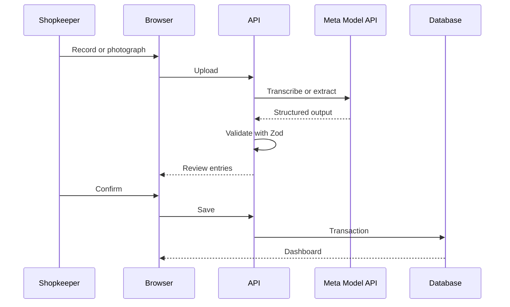
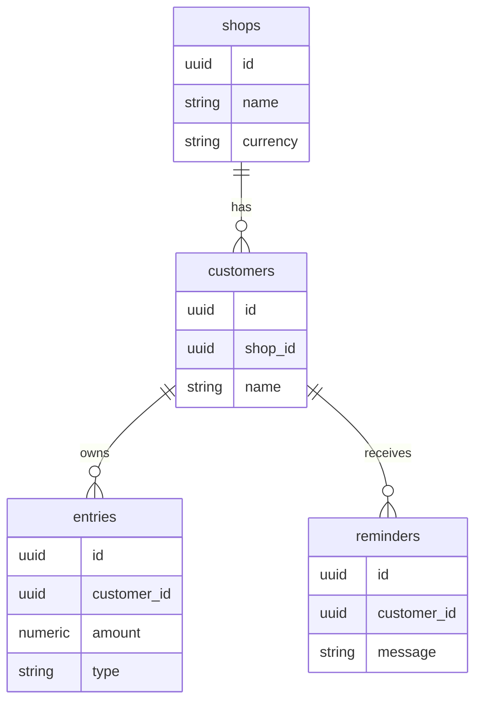
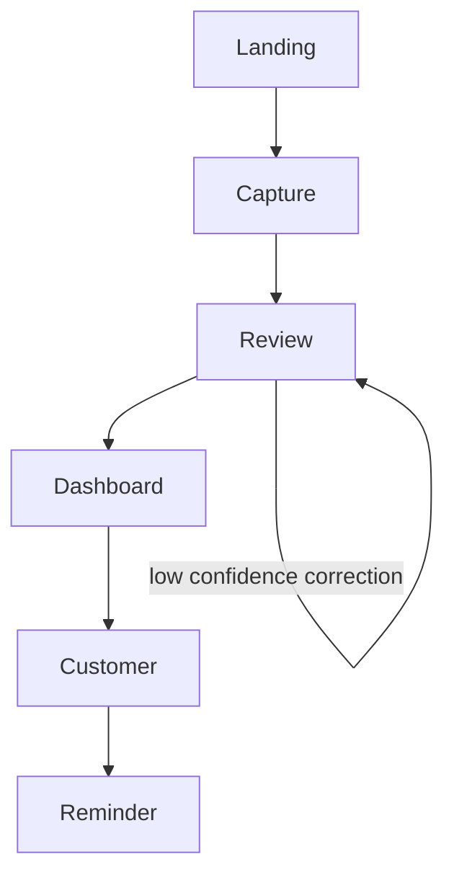

# TabTalk

**Your shop’s notebook, in any language.** TabTalk helps small shopkeepers turn spoken or handwritten credit notes into a reviewable ledger and respectful payment reminders.

[Next.js](https://nextjs.org) · TypeScript · Meta Model API · Demo: `NEXT_PUBLIC_DEMO_VIDEO_URL` · Repo: `NEXT_PUBLIC_REPO_URL`

## The Problem
Small shops give goods on credit and track trust in notebooks, memory, and loose pages. Lost pages, handwriting, mixed languages, and awkward payment chasing make this fragile. Khata, fiado, udhaar, utang, and “on credit” are versions of the same worldwide practice.

## The Solution
TabTalk follows **Landing → Capture → Review → Dashboard → Customer → Reminder**. A shopkeeper speaks or photographs a page, reviews every extracted line, sees confidence flags and original source text, saves balances, and drafts a reminder in the customer’s language.

## Demo
Screens: landing, capture, review, dashboard, customer/reminder. Set `NEXT_PUBLIC_DEMO_VIDEO_URL` for the video embed.

## Features
- Voice capture through browser MediaRecorder and handwritten-page upload.
- Server-side Meta model calls; Zod validation; review-before-save.
- Credit/paid entries, customer balances, currencies, and reminders.
- Demo shops for INR, MXN, and KES.

## How we use Meta’s models
| Model | Code | Why |
|---|---|---|
| Muse Voice Transcribe | `lib/meta.ts` / `transcribeAudio` | Speech-to-text endpoint for voice. |
| Muse Spark 1.3 vision | `lib/meta.ts` / `extractFromImage` | Handwriting and image understanding. |
| Muse Spark 1.3 text | `lib/meta.ts` / `extractFromText`, `draftReminder` | Structuring and multilingual reminders. |

Standard models are used; contributor variants are not used.

## Architecture
```mermaid
flowchart LR
 subgraph Client[Client] 
 B[Browser: Capture Review Dashboard Customer]
 end
 subgraph Vercel[Vercel]
 A[Next.js API routes] --> M[lib/meta.ts]
 A --> D[Drizzle ORM]
 end
 subgraph Meta[Meta Model API]
 M --> V[Muse Voice Transcribe]
 M --> S[Muse Spark]
 end
 subgraph Database[Database]
 D --> N[(Neon Postgres)]
 end
 B --> A
```
The browser uses route handlers; server code alone calls Meta and Neon.


The review is the correction loop before persistence.


Entries belong to customers and shops; reminders belong to customers.


Low-confidence entries stay visible until corrected.

## Tech stack
Next.js App Router · TypeScript strict · Tailwind CSS · Next route handlers · Drizzle ORM · Neon Postgres · Zod · Meta Model API.

## Project structure
```text
app/           pages and API route handlers
components/    reusable UI
lib/           Meta client, schemas, prompts, money, database
 db/           Drizzle schema and seed
scripts/       smoke checks
```

## Getting started
Prerequisites: Node 20+, Neon account, Meta Model API key and credits.

```bash
npm install
cp .env.example .env.local
npx drizzle-kit migrate
npm run seed
npm run dev
npm run smoke
```
Variables are documented in `.env.example`. Audio is limited to 60 seconds and Vercel request bodies are approximately 4.5 MB. Troubleshooting: invalid API key means check `META_API_KEY`; no credits means add credits; oversized audio/image should be shortened/compressed; Neon errors mean check `DATABASE_URL` and migrations.

## Deploying to Vercel
Push a public GitHub repository, import it into Vercel, add the Neon integration, set the environment variables, run migrations and seed against production, then verify with the smoke script. Keep the 4.5 MB body limit and 60-second route duration in mind.

## Environment variables
| Variable | Purpose |
|---|---|
| `META_API_KEY` | Server-only Meta credential |
| `META_BASE_URL` | Meta API base URL |
| `META_MODEL_VISION` / `META_MODEL_TEXT` / `META_MODEL_TRANSCRIBE` | Model IDs |
| `DATABASE_URL` | Neon Postgres connection |
| `NEXT_PUBLIC_DEMO_VIDEO_URL` / `NEXT_PUBLIC_REPO_URL` | Public landing links |

## Testing
Run `npm run smoke` with configured credentials. Manual checklist: Tamil, Spanish, and English entries; low-confidence review; confirm balances; reminder in a different language; shop/currency switch; landing CTAs; no browser API key.

## Tested languages
Only verified languages should be listed in `TESTED_LANGUAGES` in `lib/config.ts`; this build lists English, Tamil, and Spanish.

## Limitations
Handwriting accuracy varies; the demo has no authentication and uses demo shops; there is no offline mode; model output can be wrong, so review-before-save is required.

## Future scope
Multi-shop accounts, offline-first PWA, WhatsApp/SMS sending, payment links, auto-reminders, statement links, more languages, text-to-speech, CSV/PDF export, analytics, on-device/open-weight models, and family-shop roles.

## What was built during the hackathon
Everything in this repository was built during the hackathon period (Oct 26 to Nov 4, 2026): the mobile capture flow, Meta integrations, extraction review, Drizzle data model, balances, reminder drafting, demo shops, and landing page.

## Language support
TabTalk now uses a registry with native and localized names. Languages in `TESTED_LANGUAGES` are **verified**; languages listed by Meta Voice Transcribe are **speech supported**; all other languages are **best effort** through photo and text. Outside verified languages, quality varies. Voice fallback always offers typed text and manual entry. The registry is intentionally derived from `Intl.DisplayNames` rather than a short hard-coded picker.

## Privacy and security
Original photos and audio are processed in memory and are not persisted by default. Structured entries, source lines, balances, and generated reminders are stored in Neon. API keys remain server-side and Meta Standard models are used; legal review is required before commercial launch. The production upgrade adds Auth.js, organization-aware access helpers, rate-limit and usage-plan primitives, health checks, security headers, and a sandbox-compatible capture experience. Privacy and terms templates still need legal review.

## Upgrade decisions
The `saas-upgrade` branch preserves the no-signup demo path for judges while adding the server-side foundations needed for authenticated organizations. Client-provided shop IDs must not be treated as authorization; production routes should call `requireShopAccess` before database access. The demo keeps its existing seeded UI behavior until a Neon environment is attached and migrations are applied.

## Team, license, acknowledgements
Team: placeholder. MIT. Acknowledgements: Meta Model API, Neon, and Vercel.
